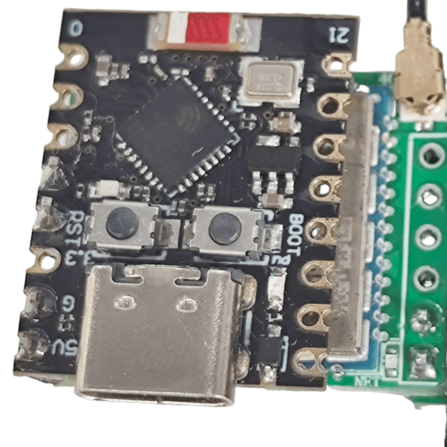
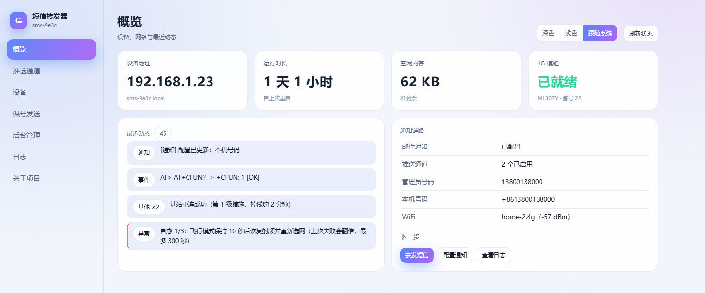
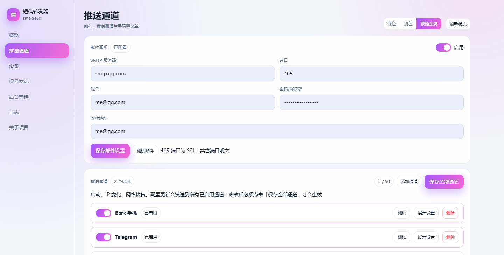
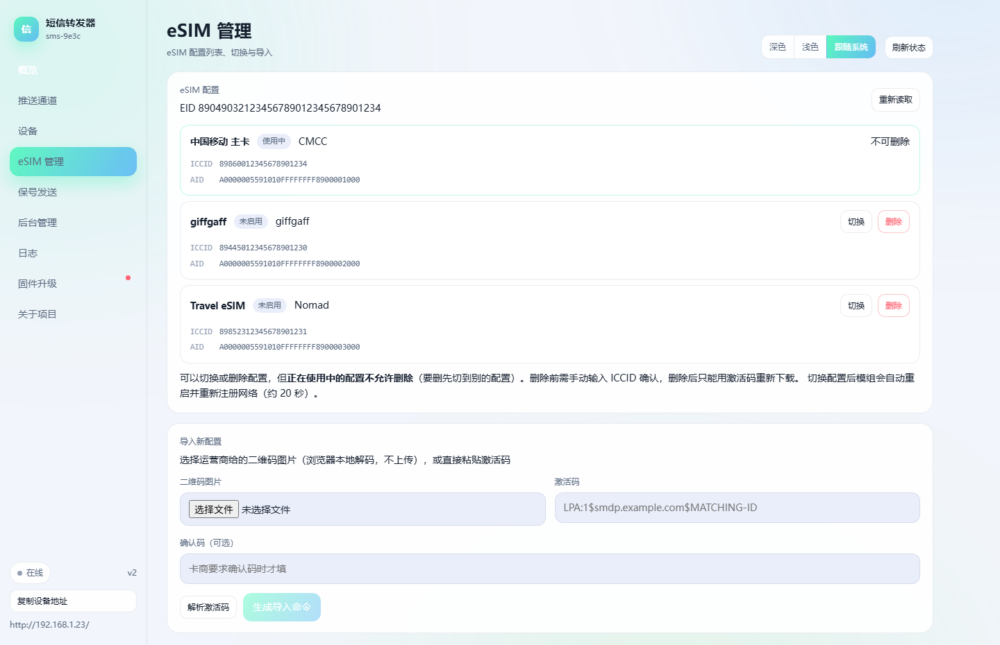
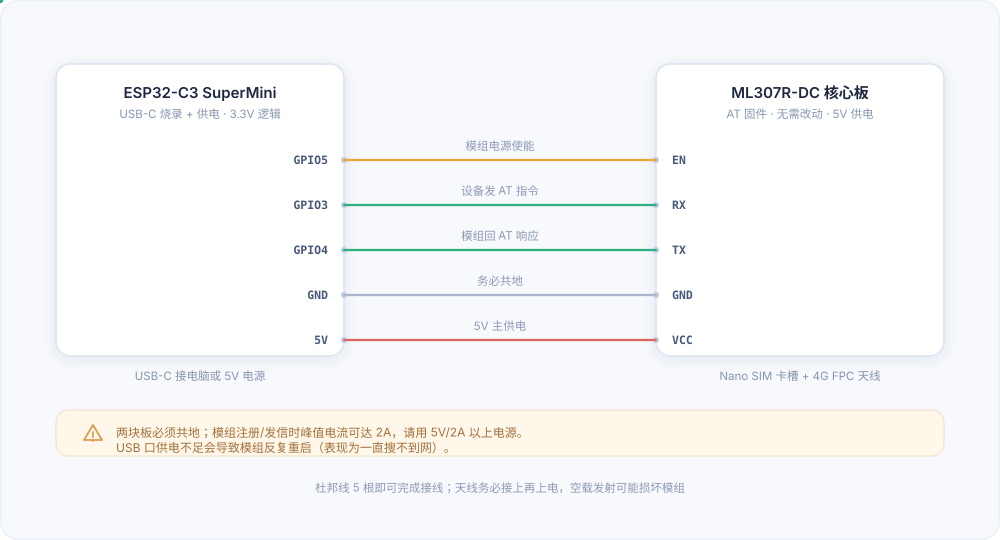

<p align="center"><a href="README.md">简体中文</a> | <b>English</b></p>

<div align="center">



# Low-cost SMS Forwarder

**One 4G SIM (physical or eSIM) + one ESP32-C3 — forward incoming SMS to email, DingTalk, Feishu, WeCom and Telegram within seconds**

[](LICENSE)
[](idf/)
[](#hardware)
[](../../actions/workflows/firmware.yml)
[](../../releases/latest)
[](https://sms.j2.cx/)

[Live demo](https://sms.j2.cx/) · [Hardware](#hardware) · [Flashing](#flashing) · [Video (Chinese)](https://www.bilibili.com/video/BV1cSmABYEiX) · [FAQ](#faq)

</div>



> **Older versions**: [`old-luatos` branch](https://github.com/chenxuuu/sms_forwarding/tree/old-luatos), [`code/`](code/) ([Arduino framework version](code/README.md))  
> The current mainline is [`idf/`](idf/).
>
> **Disclaimer**: this project is for personal study and personal use only. Follow local laws, carrier terms and SMS service agreements;
> forwarded content may involve other people's privacy, so make sure you are entitled to handle it. Any cost, account ban or legal risk
> caused by using this project is on you.
>
> **Scope**: receiving, forwarding and keeping a SIM alive — nothing else.  
> Multiple physical SIMs online at once (multi-SIM control), calls, dialing, public APIs and automation (auto-reply / auto actions)
> **will never be supported**. Please do not open issues or PRs about them.

## What it solves

Put a phone SIM (Nano SIM, or a eUICC-capable eSIM card) in the device; it joins your WiFi and watches the 4G modem.
Whenever anyone texts that number, the device parses the message, merges long SMS, applies the blacklist, then forwards it to
**all** of your configured channels at once.

- **No server, no public IP**: the device talks to mail servers and push platforms directly; message content never goes through a relay
- **~28 CNY of hardware**, runs 7×24 off a single USB cable (a dedicated 5V supply is recommended for long-term use)
- **Built for keeping SIMs alive**: low-traffic keep-alive requests plus scheduled tasks keep the card active without burning money
- **eSIM aware**: read the EID and profile list, switch or delete profiles from the web UI; scan a carrier QR code or paste an activation
  code to get the write command (writing runs on your PC, so it costs the device nothing)

## Screenshots

The firmware ships a complete web UI (~270 KB, including an embedded local QR decoder, served straight from flash) that works on phones too.
The UI is available in Chinese and English: the first visit follows your browser language (Chinese in Chinese-speaking regions, English elsewhere) and you can switch manually in the top bar.
Dark / light / follow-system themes.

| Overview | Push channels | eSIM |
|---|---|---|
| [](https://sms.j2.cx/#overview) | [](https://sms.j2.cx/#push) | [](https://sms.j2.cx/#esim) |

## Features

| Capability | Details |
|---|---|
| **Push channels** | Email + POST JSON / GET / Bark / DingTalk / Feishu / PushPlus / ServerChan / Gotify / Telegram / custom template; 5 slots by default, up to 50, each can be enabled, disabled and tested individually |
| **Long SMS** | PDU-mode decoding; multipart messages are reassembled within 30 s; CJK text stays intact |
| **Blacklist** | Filter verification-code floods and spam by sender |
| **Remote commands** | Text `SMS:number:content` from the admin number to send an SMS, `RESET` to reboot, `RESETPASS` to reset the web password and push the new one |
| **Keep-alive** | Ping or fetch a URL from the modem (10 bytes by default) to spend a minimum of balance |
| **Scheduled tasks** | Send SMS / ping / fetch a URL at a given time; missed runs catch up, failures retry once; supports "every N days" |
| **Firmware update** | Upload `*-ota.bin` in the browser; it writes the spare partition, so power loss cannot brick the device. The page shows whether a newer release exists (your browser calls GitHub, the device stays offline); a build that fails to boot rolls back automatically |
| **eSIM management** | List profiles, switch or delete them (the active profile cannot be deleted; the modem restarts and re-registers after a switch); scan a QR code or paste an activation code to get the import command |
| **Network & APN** | Automatic or manual PLMN selection; the APN is picked from the SIM by default, or you can set the APN plus username/password (PAP) — handy for foreign and IoT SIMs |
| **Self-healing** | WiFi reconnects automatically; 4G loss is handled in stages — airplane mode (10 s, doubling up to 5 min) → soft reset → power-cycle — and you are only notified after 5 consecutive failed rounds |
| **Config compatible** | NVS namespace and keys match the Arduino version, so you can upgrade from an old firmware without losing settings |

## Hardware

**No soldering**: buy the ready-made kit, same cost as building it yourself (supports China Mobile / Unicom / Telecom SIMs)

- [Xiaolanjing WiFi SMS box](https://item.taobao.com/item.htm?id=1003711355912) (ask customer service)
- [4G FPC antenna](https://item.taobao.com/item.htm?id=1003711355912&skuId=6162872574943) (buy together with the board)

**Build it yourself**: about ¥27.8 in total (prices fluctuate; the DIY build has been verified with China Mobile / Unicom SIMs)

- ESP32-C3 board: [SuperMini](https://item.taobao.com/item.htm?id=852057780489&skuId=5813710390565), ¥9.5 shipped
- 4G modem: [Xiaolanjing ML307R-DC core board](https://item.taobao.com/item.htm?id=797466121802&skuId=5722077108045), ¥16.3 shipped
- [4G FPC antenna](https://item.taobao.com/item.htm?id=797466121802&skuId=5722077108045), ¥2 with the board
- One Nano SIM (a eUICC-capable eSIM card works too, see below) + 5 Dupont wires

<p align="center"></p>

> The modem runs its stock AT firmware — **nothing to flash or modify**. It is used purely as "a serial modem that receives SMS".

## eSIM (optional)

Besides a normal Nano SIM, drop in a **eUICC card** (9eSIM, 5ber, ESTK, …) to manage several carrier profiles from the web UI:

- Read the EID and list every profile on the card (name, ICCID, AID, active or not)
- Switch with one click; delete the ones you do not need — **the active profile is never deletable**, and deletion also requires typing the ICCID
- Scan a carrier QR code (decoded locally in the browser, never uploaded) or paste a `LPA:1$…` activation code; the page produces the write command
- Downloading a new profile does not happen on the device: SGP.22 needs TLS to the SM-DP+ and a tens-of-KB encrypted package, which is too much
  for an ESP32-C3. Use `tools/esim_bridge.py` to tunnel APDUs from lpac on your PC to the device — same result as clicking in the web UI

Full walkthrough (install lpac, download, switch, delete, common errors): **[idf/docs/esim-import.md](idf/docs/esim-import.md)**.

## Flashing

Two options, pick one.

### Option 1: flash a prebuilt image (no toolchain needed)

1. Download `sms_forwarder-merged.bin` from [Releases](../../releases/latest)
2. Flash it (open [ESP Launchpad](https://espressif.github.io/esp-launchpad/) in Chrome / Edge):
   - Chip **ESP32-C3**, address `0x0`, pick the file you just downloaded
   - Or on the command line: `esptool.py --chip esp32c3 -p COM3 write_flash 0x0 sms_forwarder-merged.bin`
3. Provision WiFi: join the `SMS-Forwarder-XXXX` hotspot (no password) → open <http://192.168.4.1/> → pick your WiFi, enter the password → it reboots onto your network

> **Do not flash the merged image onto a device already in use**: it fills gaps with 0xFF and wipes NVS, losing all settings.
> Use `idf.py flash`, or write only `0x0/0x8000/0x20000`; once provisioned you can also upload an OTA package from the web UI.

GitHub Actions builds the firmware on every push; it is identical to a local build.

### Option 2: build it yourself

You need **ESP-IDF v6.1.1** ([official installer](https://docs.espressif.com/projects/esp-idf/en/latest/esp32c3/get-started/index.html)) and a USB-C data cable.

```bash
git clone https://github.com/chenxuuu/sms_forwarding.git
cd sms_forwarding/idf
idf.py build            # 3-5 minutes the first time
idf.py -p COM3 flash    # use your port: COMx on Windows, /dev/ttyACM0 on Linux
```

Then provision WiFi as in step 3 above. For batch flashing, pre-fill WiFi under `idf.py menuconfig → SMS forwarder` and skip provisioning.

### First-time setup

1. Open `http://<device-ip>/` or the mDNS name `http://sms-xxxx.local/` (suffix is in the serial log)
2. Default account `admin` / `admin123` — **change it right away on the Admin page**
3. On "Push channels", fill in email or any channel and hit "Test" to confirm delivery
4. On "Admin", set the admin phone number (for remote SMS commands) and the local number (included in pushes)
5. With an eSIM card, open "eSIM": if you can read the EID and profile list, the card is fine; see the [import guide](idf/docs/esim-import.md) to add a profile

## FAQ

| Symptom | Cause and fix |
|---|---|
| Stuck on "reconnecting", no SMS arriving | The 4G modem is not registered. Check `+CEREG` in the log; if the modem hangs, **power-cycling it** is the quickest fix. For 24/7 use, power it from a dedicated 5V supply rather than a PC USB port |
| The device IP keeps changing | Router DHCP. The device pushes a notification when its address changes; bind its MAC in the router, or just use the mDNS name |
| Changed router / WiFi password | After 3 failed boots it opens the `SMS-Forwarder-XXXX` hotspot; join it and re-enter the credentials, or pre-set them via `menuconfig` before flashing |
| Want to change carrier / lock the network | "Device → Network selection": choose manual and fill in the PLMN (China Mobile `46000`, Unicom `46001`, Telecom `46011`), save and reboot |
| Mobile data stops working after swapping SIMs | Leave the APN blank so the modem picks it from the SIM; if that fails, enter the carrier APN under "Device → Network selection" (common for foreign SIMs, e.g. giffgaff: `giffgaff.com`, user `gg`, password `p`), save and reboot |
| Pushes fail but the web UI works | Hit "Test" on that channel to see the error; usually a wrong token / webhook or a platform-side limit |
| "Check failed" on the firmware page | The version check is your **browser** calling `api.github.com`; if that is blocked you simply get no prompt, and the device is unaffected — download `*-ota.bin` from [Releases](https://github.com/chenxuuu/sms_forwarding/releases) and upload it |
| The eSIM page cannot read the EID | The card is not eUICC (a normal SIM is not), or a previous operation left a logical channel open. Soft-reset the modem on the "Device" page and retry |
| Stuck on "reconnecting" after switching profiles | Roaming attach is genuinely slow; a few minutes is normal — **if you can read the ICCID the card is fine**. Soft-reset the modem if you are impatient |
| Writing a profile fails with `es9p_authenticate_client: Refused` | The activation code expired or is blocked by the carrier; try another one. Use lpac 2.2.1 (the Windows build of 2.3.0 has a broken stdio backend) |

More field notes: [idf/docs/build-flash.md](idf/docs/build-flash.md).

## Project layout

```
sms_forwarding/
├── idf/                    # mainline: ESP-IDF v6.1.1 implementation
│   ├── components/         # core / modem / net / notify / forwarder / sched / ota / esim / web
│   ├── docs/               # architecture, modules, API, build & flash notes
│   └── tools/              # serial log capture script
├── code/                   # legacy: Arduino framework
│   ├── dev_doc/            # Arduino version architecture and API docs
│   └── README.md
├── assets/                 # images, diagrams, pure-frontend demo page
├── tools/
│   └── esim_bridge.py      # forwards lpac APDUs to the device (runs on your PC)
├── README.md               # Chinese
├── README.en.md            # English (this file)
└── .github/workflows/      # firmware build, pages deploy, Arduino build
```

Want to change the code? Read [idf/docs/architecture.md](idf/docs/architecture.md) and [idf/docs/modules.md](idf/docs/modules.md) first;
the project conventions (logging, config locks, how to add a push channel) are in [AGENTS.md](AGENTS.md).

## License

Released under the [MIT](LICENSE) license.

The eSIM and QR-code parts use or reference the following projects, each under its own license:

| Project | License | Use |
|---|---|---|
| [jsQR](https://github.com/cozmo/jsQR) | Apache-2.0 | In-browser QR decoding (embedded in the web page; full text in [`idf/components/web/web/jsQR.LICENSE.txt`](idf/components/web/web/jsQR.LICENSE.txt)) |
| [lpac](https://github.com/estkme-group/lpac) | AGPL-3.0 / LGPL-2.1 | eSIM (SGP.22) flow reference; runs as a **standalone program** on your PC, its code is not part of the firmware |
| [euicc-go](https://github.com/damonto/euicc-go) | MIT | eSIM APDU flow reference |

Full walkthrough (install lpac, download, switch, delete): [idf/docs/esim-import.md](idf/docs/esim-import.md).
Protocol details and design trade-offs: [idf/docs/esim-plan.md](idf/docs/esim-plan.md).
